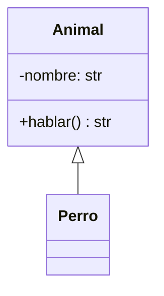

# Skill: diseño de clases POO

## Cuándo usarla
Cuando haya que convertir una idea o enunciado en un diseño orientado a objetos.

## Pasos
1. **Sustantivos → clases candidatas.** Subraya los sustantivos importantes del enunciado.
2. **Verbos → métodos.** Cada acción importante es un método de alguna clase.
3. **Datos → atributos.** Decide a qué clase pertenece cada dato.
4. **Relaciones:**
   - Herencia ("es un"): solo si hay comportamiento compartido real.
   - Composición ("tiene un", el todo controla las partes).
   - Asociación ("usa a").
5. **Polimorfismo:** busca métodos que varíen según el tipo (por ejemplo `calcular_total()`).
6. **Revisar:** cada clase debe tener una sola responsabilidad.

## Formato de salida (`docs/diseno.md`)
- Problema en 2-3 líneas.
- Tabla: Clase | Responsabilidad | Atributos | Métodos.
- Diagrama:

````

````

## Errores comunes
- Crear clases que solo tienen datos y ninguna conducta.
- Usar herencia solo para reutilizar código.
- Clases "Manager" que lo hacen todo.
