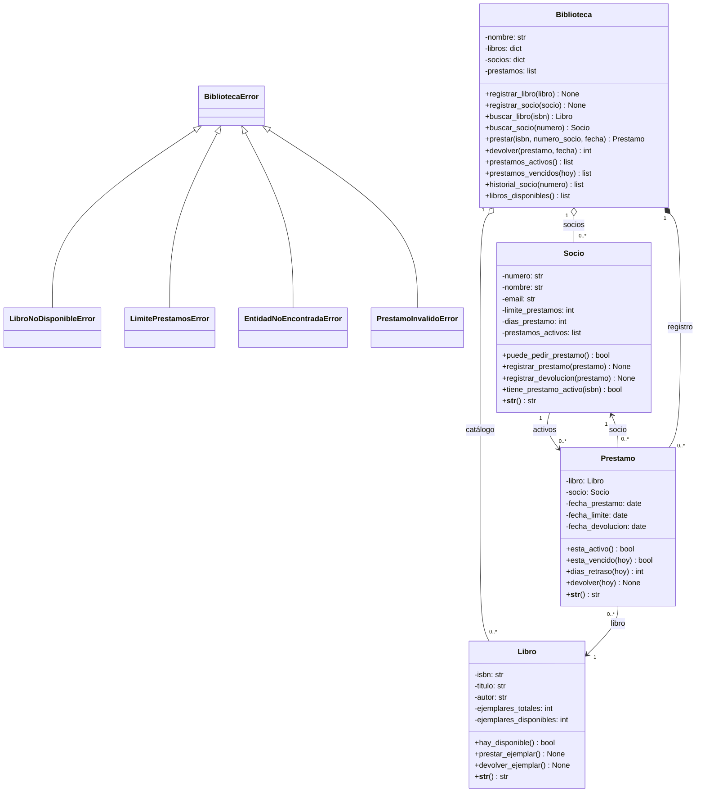

# Sistema de biblioteca con agentes de IA en OpenCode

Este repositorio contiene dos partes:

1. Un **sistema de agentes** construido con OpenCode para diseñar, implementar, probar y
   revisar programas en Python.
2. Una **aplicación de ejemplo**: un sistema de biblioteca con libros, socios y préstamos.

## 1. El programa: sistema de biblioteca

La aplicación permite:

- registrar libros con uno o varios ejemplares,
- registrar socios con un límite de préstamos,
- prestar y devolver libros,
- consultar disponibilidad, préstamos activos, préstamos vencidos e historial de un socio.

Reglas principales:

- máximo **3 préstamos activos** por socio (configurable en `Socio`),
- plazo normal de **14 días** por préstamo (configurable en `Socio`),
- un socio no puede tener dos préstamos activos del mismo libro,
- no se cobran multas: solo se calculan los días de retraso.

## 2. Cómo ejecutar el programa

Requisito: Python 3.10 o superior. El proyecto fue probado con Python 3.13.

```powershell
python src/main.py
```

En Windows, si la consola no muestra correctamente los acentos:

```powershell
python -X utf8 src/main.py
```

## 3. Cómo ejecutar las pruebas

Con `unittest`, incluido en Python:

```powershell
python -m unittest discover -s tests -v
```

Si tienes `pytest` instalado, también puedes usar:

```powershell
python -m pytest -v
```

Resultado actual: **100 pruebas ejecutadas, 100 aprobadas, 0 fallidas**.

## 4. Estructura de carpetas

```text
.
├── .opencode/
│   ├── agent/                  # arquitecto, desarrollador, tester, revisor
│   └── skill/                  # skills de diseño, código, pruebas y revisión
├── docs/
│   ├── diseno.md               # diseño de clases y diagrama
│   ├── reporte-pruebas.md      # resultados de las pruebas
│   ├── revision.md             # revisión final del proyecto
│   └── guion-video.md
├── src/
│   ├── __init__.py
│   ├── excepciones.py
│   ├── libro.py
│   ├── socio.py
│   ├── prestamo.py
│   ├── biblioteca.py
│   └── main.py                 # demostración ejecutable
├── tests/
│   ├── test_libro.py
│   ├── test_socio.py
│   ├── test_prestamo.py
│   └── test_biblioteca.py
└── README.md
```

## 5. Diagrama de clases



El diseño completo, con validaciones y reglas de negocio, está en
[`docs/diseno.md`](docs/diseno.md).

## 6. Agentes del sistema (`.opencode/agent/`)

| Agente | Rol |
|---|---|
| `arquitecto` | Diseña las clases y el diagrama (`docs/diseno.md`) |
| `desarrollador` | Escribe el código en `src/` a partir del diseño |
| `tester` | Crea y ejecuta pruebas en `tests/` y reporta (`docs/reporte-pruebas.md`) |
| `revisor` | Revisa todo y documenta (`docs/revision.md`) |

## 7. Skills (`.opencode/skill/`)

| Skill | Usada por | Para qué |
|---|---|---|
| `diseno-clases-poo` | arquitecto | Identificar clases, relaciones y diagramas Mermaid |
| `escritura-codigo-python` | desarrollador | Convenciones y plantilla de clases en Python |
| `pruebas-unitarias-python` | tester | Casos normales, límite y de error con pytest o unittest |
| `revision-y-documentacion` | revisor | Checklist de revisión y README |

## 8. Flujo de trabajo

1. El usuario describe el programa que quiere.
2. **Arquitecto** → `docs/diseno.md`
3. **Desarrollador** → `src/`
4. **Tester** → `tests/` + `docs/reporte-pruebas.md`
5. **Revisor** → `docs/revision.md`

## 9. Cómo usar el sistema agéntico

1. Instala OpenCode y abre esta carpeta: `opencode`
2. Elige el agente con la tecla `Tab` (o menciónalo con `@arquitecto`, `@desarrollador`,
   `@tester`, `@revisor`).
3. Pide, por ejemplo: *"Diseña un sistema de biblioteca con libros, socios y préstamos"*.
4. Pasa al desarrollador, luego al tester y al revisor.

## 10. Documentación

- [`docs/diseno.md`](docs/diseno.md): clases, relaciones, invariantes y diagrama.
- [`docs/reporte-pruebas.md`](docs/reporte-pruebas.md): resultados de las 100 pruebas.
- [`docs/revision.md`](docs/revision.md): checklist, observaciones y veredicto final.
