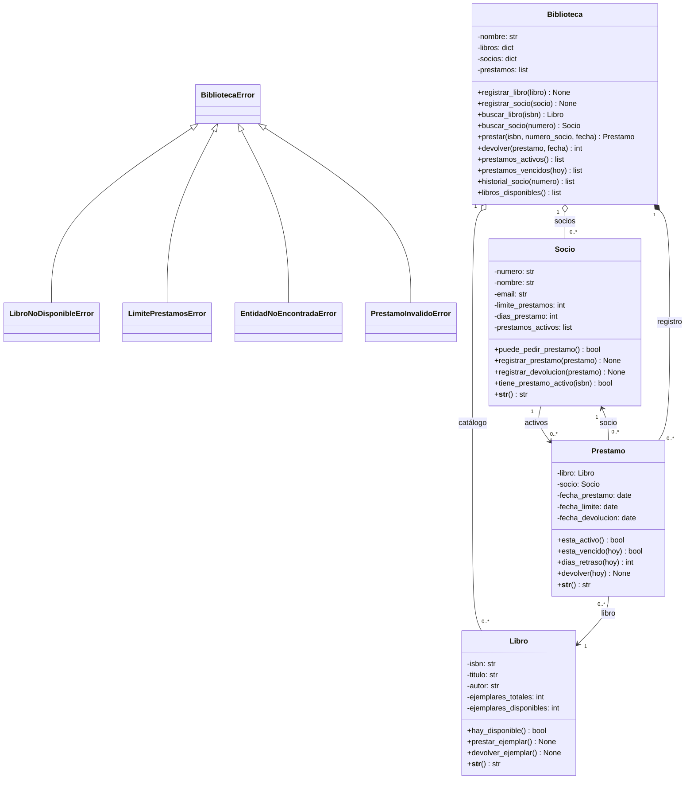

# Diseño: Sistema de Biblioteca

## 1. Problema

Se necesita gestionar un catálogo de libros con varias copias, registrar socios y controlar
los préstamos y devoluciones. El sistema debe conocer la disponibilidad de cada libro,
limitar cuántos préstamos puede tener un socio, calcular vencimientos y detectar retrasos.

## 2. Alcance y supuestos

- Cada libro tiene un ISBN único y puede tener **N ejemplares**.
- Un socio se identifica por un número único y puede tener como máximo **3 préstamos activos**.
- El plazo normal de un préstamo es de **14 días**.
- Un socio no puede tener dos préstamos activos del mismo libro.
- No se cobran multas: solo se informan los días de retraso.
- Las fechas se reciben como parámetros opcionales (`date`) para poder probar el sistema
  de forma determinista, sin depender del reloj del equipo.

## 3. Clases

| Clase | Responsabilidad | Atributos | Métodos principales |
|---|---|---|---|
| `Libro` | Representar un título y controlar la disponibilidad de sus ejemplares. | `_isbn: str`<br>`_titulo: str`<br>`_autor: str`<br>`_ejemplares_totales: int`<br>`_ejemplares_disponibles: int` | `hay_disponible()`<br>`prestar_ejemplar()`<br>`devolver_ejemplar()`<br>`__str__()` |
| `Socio` | Representar a un socio y controlar su límite y sus préstamos activos. | `_numero: str`<br>`_nombre: str`<br>`_email: str`<br>`_limite_prestamos: int`<br>`_dias_prestamo: int`<br>`_prestamos_activos: list[Prestamo]` | `puede_pedir_prestamo()`<br>`registrar_prestamo()`<br>`registrar_devolucion()`<br>`tiene_prestamo_activo()`<br>`__str__()` |
| `Prestamo` | Representar el vínculo temporal entre un libro y un socio, y calcular su estado. | `_libro: Libro`<br>`_socio: Socio`<br>`_fecha_prestamo: date`<br>`_fecha_limite: date`<br>`_fecha_devolucion: date \| None` | `esta_activo()`<br>`esta_vencido()`<br>`dias_retraso()`<br>`devolver()`<br>`__str__()` |
| `Biblioteca` | Coordinar el catálogo, los socios y los préstamos; validar las reglas de negocio. | `_nombre: str`<br>`_libros: dict[str, Libro]`<br>`_socios: dict[str, Socio]`<br>`_prestamos: list[Prestamo]` | `registrar_libro()`<br>`registrar_socio()`<br>`buscar_libro()`<br>`buscar_socio()`<br>`prestar()`<br>`devolver()`<br>`prestamos_activos()`<br>`prestamos_vencidos()`<br>`historial_socio()`<br>`libros_disponibles()` |

### 3.1 `Libro`

**Responsabilidad:** ser dueño del estado de sus ejemplares. Ninguna otra clase modifica
directamente `_ejemplares_disponibles`.

**Constructor**

```text
Libro(isbn: str, titulo: str, autor: str, ejemplares_totales: int = 1)
```

**Validaciones**

- `isbn`, `titulo` y `autor` no pueden estar vacíos.
- `ejemplares_totales >= 1`.
- `_ejemplares_disponibles` inicia igual a `ejemplares_totales`.

**Métodos**

- `hay_disponible() -> bool`: indica si hay al menos un ejemplar libre.
- `prestar_ejemplar() -> None`: descuenta un ejemplar. Lanza `LibroNoDisponibleError` si no hay.
- `devolver_ejemplar() -> None`: incrementa un ejemplar. Lanza `PrestamoInvalidoError` si
  ya están todos disponibles (evita devoluciones dobles).
- Propiedades de solo lectura para todos los atributos.
- `__str__()`: por ejemplo, `"Cien años de soledad (ISBN 123) - 2/3 disponibles"`.

### 3.2 `Socio`

**Responsabilidad:** conocer sus datos, su límite de préstamos y cuáles tiene activos.
No modifica el estado de los libros; eso lo coordina `Biblioteca`.

**Constructor**

```text
Socio(numero: str, nombre: str, email: str,
      limite_prestamos: int = 3, dias_prestamo: int = 14)
```

**Validaciones**

- `numero`, `nombre` y `email` no pueden estar vacíos.
- `email` debe tener un formato básico: algo antes y después de `@`, con un punto en el dominio.
- `limite_prestamos >= 1` y `dias_prestamo >= 1`.

**Métodos**

- `puede_pedir_prestamo() -> bool`: `len(_prestamos_activos) < _limite_prestamos`.
- `registrar_prestamo(prestamo: Prestamo) -> None`: añade el préstamo a la lista activa.
- `registrar_devolucion(prestamo: Prestamo) -> None`: lo quita de la lista activa.
- `tiene_prestamo_activo(isbn: str) -> bool`: evita prestar dos veces el mismo libro al mismo socio.
- Propiedad `prestamos_activos` que devuelve una **tupla** (copia inmutable) para no exponer la lista interna.
- `__str__()`.

### 3.3 `Prestamo`

**Responsabilidad:** representar el préstamo y su ciclo de vida (`ACTIVO` → `DEVUELTO`).
No descuenta ejemplares ni actualiza al socio: eso lo hace `Biblioteca` de forma coordinada.

**Constructor**

```text
Prestamo(libro: Libro, socio: Socio,
         fecha_prestamo: date | None = None,
         dias_prestamo: int | None = None)
```

- Si `fecha_prestamo` es `None`, usa `date.today()`.
- Si `dias_prestamo` es `None`, usa `socio.dias_prestamo`.
- `_fecha_limite = _fecha_prestamo + timedelta(days=dias_prestamo)`.
- `_fecha_devolucion` inicia en `None`.

**Métodos**

- `esta_activo() -> bool`: `_fecha_devolucion is None`.
- `dias_retraso(hoy: date | None = None) -> int`:
  - Referencia = `_fecha_devolucion` si ya se devolvió; si no, `hoy` o `date.today()`.
  - Resultado = `max(0, (referencia - _fecha_limite).days)`.
- `esta_vencido(hoy: date | None = None) -> bool`: `dias_retraso(hoy) > 0`.
- `devolver(hoy: date | None = None) -> None`: registra la fecha de devolución.
  Lanza `PrestamoInvalidoError` si el préstamo ya estaba devuelto.
- Propiedades de solo lectura para libro, socio y fechas.
- `__str__()`.

### 3.4 `Biblioteca`

**Responsabilidad:** ser la fachada del sistema. Centraliza las operaciones para que el
estado de libros, socios y préstamos siempre sea consistente.

**Constructor**

```text
Biblioteca(nombre: str)
```

**Métodos**

- `registrar_libro(libro: Libro) -> None`: añade al catálogo. `ValueError` si el ISBN ya existe.
- `registrar_socio(socio: Socio) -> None`: añade a los socios. `ValueError` si el número ya existe.
- `buscar_libro(isbn: str) -> Libro`: lanza `EntidadNoEncontradaError` si no existe.
- `buscar_socio(numero: str) -> Socio`: lanza `EntidadNoEncontradaError` si no existe.
- `prestar(isbn: str, numero_socio: str, fecha: date | None = None) -> Prestamo`:
  1. Busca libro y socio.
  2. Comprueba `libro.hay_disponible()`; si no, `LibroNoDisponibleError`.
  3. Comprueba `socio.puede_pedir_prestamo()`; si no, `LimitePrestamosError`.
  4. Comprueba `socio.tiene_prestamo_activo(isbn)`; si sí, `PrestamoInvalidoError`.
  5. Crea el `Prestamo`, ejecuta `libro.prestar_ejemplar()`,
     `socio.registrar_prestamo(prestamo)` y lo guarda en `_prestamos`.
  6. Devuelve el préstamo creado.
- `devolver(prestamo: Prestamo, fecha: date | None = None) -> int`:
  1. Verifica que el préstamo pertenezca a la biblioteca y esté activo.
  2. Ejecuta `prestamo.devolver(fecha)`, `libro.devolver_ejemplar()` y
     `socio.registrar_devolucion(prestamo)`.
  3. Devuelve los días de retraso (0 si llegó a tiempo).
- `prestamos_activos() -> list[Prestamo]`.
- `prestamos_vencidos(hoy: date | None = None) -> list[Prestamo]`: solo préstamos activos con retraso.
- `historial_socio(numero: str) -> list[Prestamo]`: todos los préstamos (activos e históricos) del socio.
- `libros_disponibles() -> list[Libro]`: libros con al menos un ejemplar libre.

### 3.5 Excepciones

Jerarquía propia para distinguir los errores de negocio de los errores de datos:

- `BibliotecaError(Exception)`: base de todos los errores del dominio.
- `LibroNoDisponibleError(BibliotecaError)`.
- `LimitePrestamosError(BibliotecaError)`.
- `EntidadNoEncontradaError(BibliotecaError)`.
- `PrestamoInvalidoError(BibliotecaError)`.

Los datos inválidos en constructores se reportan con `ValueError` estándar.

### 3.6 Constantes del dominio

```text
LIMITE_PRESTAMOS_POR_DEFECTO = 3
DIAS_PRESTAMO_POR_DEFECTO = 14
```

Se definen en `socio.py` y se usan como valores por defecto del constructor.

## 4. Relaciones

- **Biblioteca ◆—— Libro** (agregación): la biblioteca mantiene el catálogo, pero un libro
  puede existir fuera de ella.
- **Biblioteca ◆—— Socio** (agregación): la biblioteca mantiene el registro de socios.
- **Biblioteca ◆—— Prestamo** (composición): la biblioteca crea y conserva el registro de
  préstamos; sin biblioteca no hay historial.
- **Prestamo ——> Libro** (asociación): cada préstamo referencia exactamente un libro.
- **Prestamo ——> Socio** (asociación): cada préstamo pertenece a exactamente un socio.
- **Socio ——> Prestamo** (asociación): el socio guarda la lista de sus préstamos activos.
- **Herencia:** solo en la jerarquía de excepciones. No se crea una superclase para `Libro`
  o `Socio` porque no comparten comportamiento real; hacerlo sería herencia artificial.

## 5. Diagrama de clases



## 6. Reglas e invariantes

1. `0 <= ejemplares_disponibles <= ejemplares_totales` siempre.
2. Solo `Biblioteca` coordina una operación completa de préstamo o devolución.
3. Un préstamo está activo mientras `fecha_devolucion` sea `None`.
4. Un préstamo devuelto no se puede devolver otra vez.
5. La fecha límite se calcula al crear el préstamo y no cambia.
6. Los días de retraso nunca son negativos.
7. Un socio no puede superar su límite de préstamos activos.
8. Un socio no puede tener dos préstamos activos del mismo ISBN.
9. No se puede prestar un libro sin ejemplares disponibles.

## 7. Decisiones de diseño

- **Encapsulamiento:** todos los atributos son privados y se exponen con `@property` de solo
  lectura. Las listas internas se devuelven como copias (`tuple` o `list` nueva).
- **Una sola responsabilidad:** `Libro` gestiona ejemplares; `Socio`, sus préstamos;
  `Prestamo`, sus fechas; `Biblioteca`, la coordinación.
- **Sin herencia artificial:** `Libro` y `Socio` no heredan de nada porque no comparten
  comportamiento. La única herencia con sentido está en las excepciones.
- **Polimorfismo útil:** cualquier error de negocio puede capturarse como `BibliotecaError`,
  sin obligar al llamador a conocer cada subclase.
- **Fechas inyectables:** facilitan las pruebas de vencimientos y retrasos.
- **Extensión futura:** si se necesitan tipos de socio con privilegios distintos, se puede
  crear `SocioPremium(Socio)` sobrescribiendo `limite_prestamos` y `dias_prestamo` sin
  modificar `Biblioteca`. No se incluye ahora para no complicar el diseño.

## 8. Lo que debe implementar el agente desarrollador

Orden recomendado:

1. **`src/excepciones.py`**: crear `BibliotecaError` y sus cuatro subclases.
2. **`src/libro.py`**: implementar `Libro` con validaciones, propiedades, disponibilidad y
   `__str__`. Usar las excepciones del paso 1.
3. **`src/socio.py`**: implementar `Socio`, sus validaciones, límite, lista de préstamos
   activos y `__str__`. Usar `from __future__ import annotations` y `TYPE_CHECKING` para
   evitar importación circular con `Prestamo`.
4. **`src/prestamo.py`**: implementar `Prestamo` con cálculo de fecha límite, estado,
   retraso y devolución.
5. **`src/biblioteca.py`**: implementar `Biblioteca` con registro, búsqueda, préstamo,
   devolución e informes. Validar todas las reglas de la sección 6.
6. **`src/__init__.py`**: exportar las clases y excepciones públicas.
7. **`src/main.py`**: crear una demostración breve: registrar dos libros y un socio,
   prestar un ejemplar, consultar disponibilidad, devolver y mostrar el resultado.
8. **Verificación**: ejecutar `python src/main.py` y confirmar que no hay errores de
   importación ni de ejecución. Después, el agente tester escribirá las pruebas unitarias.
